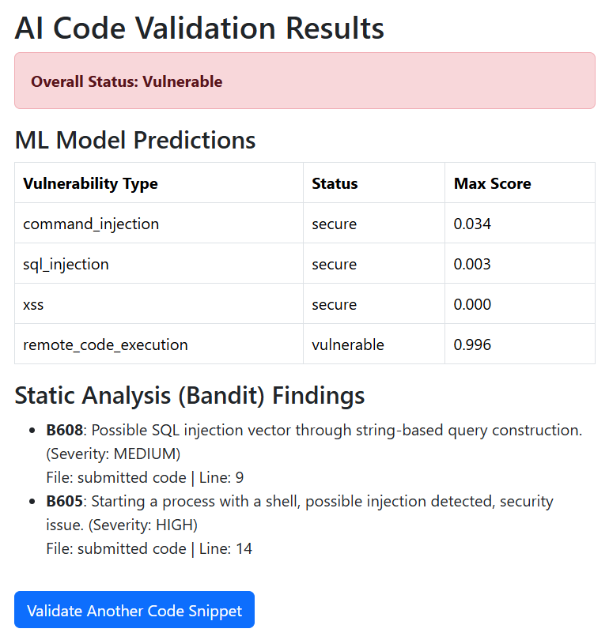

# AI Code Validation

A Flask web app that checks Python code for security vulnerabilities by combining
**deep learning** (Word2Vec + LSTM models) with **static analysis** (Bandit).

Paste a code snippet, and the app reports:

- a prediction from four LSTM models, one per vulnerability type:
  **SQL injection**, **command injection**, **XSS** and **remote code execution**
- Bandit's rule-based findings with their severity
- an overall verdict that combines both



## How it works

```
code ──► strip comments ──► tokenize ──► Word2Vec (300-d) ──► sliding windows (50 tokens, padded to 100)
                                                                         │
                                      ┌──────────────────────────────────┤
                                      ▼                                  ▼
                           4 × LSTM classifiers                    Bandit (static)
                                      └───────────────┬──────────────────┘
                                                      ▼
                                          aggregated verdict
```

1. **Preprocessing** ([scripts/preprocessing.py](scripts/preprocessing.py)): the code is tokenized
   (identifiers *and* operators/punctuation are kept as tokens), each token is embedded with a
   Word2Vec model trained on Python source, and the sequence is cut into overlapping 50-token
   windows, front-padded to 100 tokens to match the training samples.
2. **ML detection** ([scripts/ml_module.py](scripts/ml_module.py)): each LSTM model scores every
   window; the code is flagged for that vulnerability type if any window scores above 0.5.
3. **Static analysis** ([scripts/non_ml_module.py](scripts/non_ml_module.py)): Bandit runs on the
   same code.
4. **Aggregation** ([scripts/aggregator.py](scripts/aggregator.py)): the overall status is
   *vulnerable* if any model flags the code or Bandit reports a MEDIUM/HIGH severity issue.

## Model performance

Measured on a **test set of repositories the model never saw during training** (2,500 samples
per model). The last column is the F1 a trivial "flag everything as vulnerable" classifier would
get on the same data — the bar a useful model has to clear.

| Model | Precision | Recall | F1 | Flag-everything F1 | Test repos |
|---|---|---|---|---|---|
| SQL injection | 0.47 | 0.49 | **0.48** | 0.54 | 12 |
| Command injection | 0.66 | 0.34 | **0.45** | 0.33 | 6 |
| XSS | 0.77 | 0.02 | **0.04** | 0.33 | 5 |
| Remote code execution\* | 0.70 | 0.58 | **0.64** | 0.28 | 4 |

\* The remote code execution model is the earlier model, kept because it scored higher than its
retrained version (F1 0.17). Its training split was random and wasn't recorded, so some of these
"unseen" test repositories may have been in its training data — **its score is likely inflated**.

Per-model details (confusion matrices, train/validation scores, repositories per split) are in
[training/results/](training/results/). To reproduce the comparison:
`python -m training.compare_models --data-dir <path-to-data>`.

### What I found

While evaluating the models I found two problems in the original training pipeline (inherited
from the VUDENC reference code) and fixed them in [training/train.py](training/train.py):

1. **The models were trained on almost-blank input.** `pad_sequences` defaults to `dtype="int32"`,
   which truncated every Word2Vec value in (−1, 1) to 0 — 98.9% of the values. After padding,
   0.0% of the training input was non-zero, so the original models could barely learn from the
   code. Keeping the input as `float32` and retraining took SQL injection from F1 0.06 to 0.48
   and command injection from 0.10 to 0.45 on the same test set.
2. **The evaluation leaked test data.** Samples are 200-character windows that slide 5
   characters at a time, so neighbouring samples are ~97% identical. A random per-sample split
   puts near-copies of training samples in the test set: with that split the XSS model scored
   F1 0.97, but on unseen repositories it scores 0.04. Splitting **by repository** gives an
   honest estimate of performance on new code.

**Takeaway:** these token-sequence models learn project-specific style more than vulnerability
patterns, and generalize poorly to unseen projects — XSS in particular, where the dataset has only
8 repositories. That is why the app pairs them with Bandit's rule-based analysis rather than
relying on the models alone.

## Getting started

Requires Python 3.9–3.11 (TensorFlow 2.15).

```bash
git clone <this-repo-url>
cd AI_Code_Validation_Project_w2v
python -m venv venv
venv\Scripts\activate          # Windows  (macOS/Linux: source venv/bin/activate)
pip install -r requirements.txt
python app.py
```

Then open http://localhost:5050.

### Running the tests

```bash
python -m pytest
```

### Retraining a model

Training uses the VUDENC commit dataset (`plain_<type>` JSON files, see Credits):

```bash
python -m training.train sql --data-dir path/to/data      # also: xss, command_injection, remote_code_execution
```

The model and its metrics are written to `training/output/`. Each model takes 10–25 minutes on a
laptop CPU and needs about 2 GB of free RAM.

## Project structure

```
app.py                  Flask app (routes, model loading)
scripts/
  preprocessing.py      tokenization, Word2Vec embedding, sliding windows
  ml_module.py          LSTM inference
  non_ml_module.py      Bandit wrapper
  aggregator.py         combines ML + Bandit results
  myutils.py            tokenizer and F1 metric helpers
models/                 trained Word2Vec and LSTM models
training/
  train.py              model training (repository split, float32 inputs)
  vudenc_data.py        extracts labelled code samples from commit data
  compare_models.py     evaluates two sets of models on the same test sets
  results/              metrics for each trained model
templates/              HTML pages
tests/                  pytest tests
```

## Limitations

- Python code only.
- Comment stripping is line-based, so a `#` inside a string literal is treated as a comment.
- Models judge token patterns, not data flow, so they can miss vulnerabilities or raise false
  positives; treat results as a review aid, not a guarantee.
- On unseen projects the models are weak (see [Model performance](#model-performance)); the XSS
  model in particular rarely flags anything.

## Credits

The LSTM and Word2Vec models in this repository were trained by me on the VUDENC dataset. The
approach (Word2Vec embeddings of code tokens fed into per-vulnerability LSTM classifiers), the
dataset, and the tokenization and sample-extraction code in [scripts/myutils.py](scripts/myutils.py)
and [training/vudenc_data.py](training/vudenc_data.py) are adapted from **VUDENC**:

> L. Wartschinski, Y. Noller, T. Vogel, T. Kehrer, L. Grunske.
> *VUDENC: Vulnerability Detection with Deep Learning on a Natural Codebase for Python.*
> Information and Software Technology, 2022.
> https://github.com/LauraWartschinski/VulnerabilityDetection
